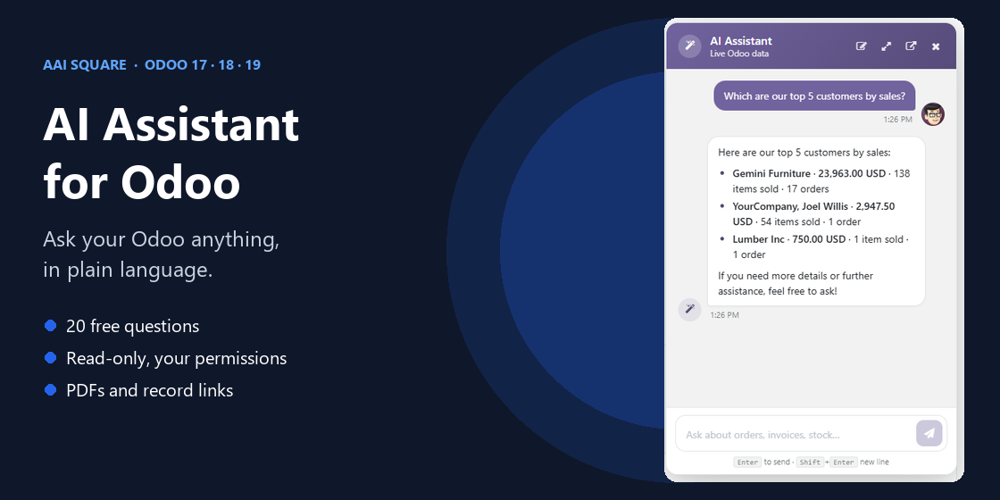
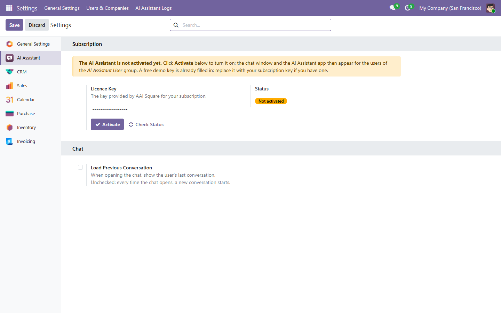
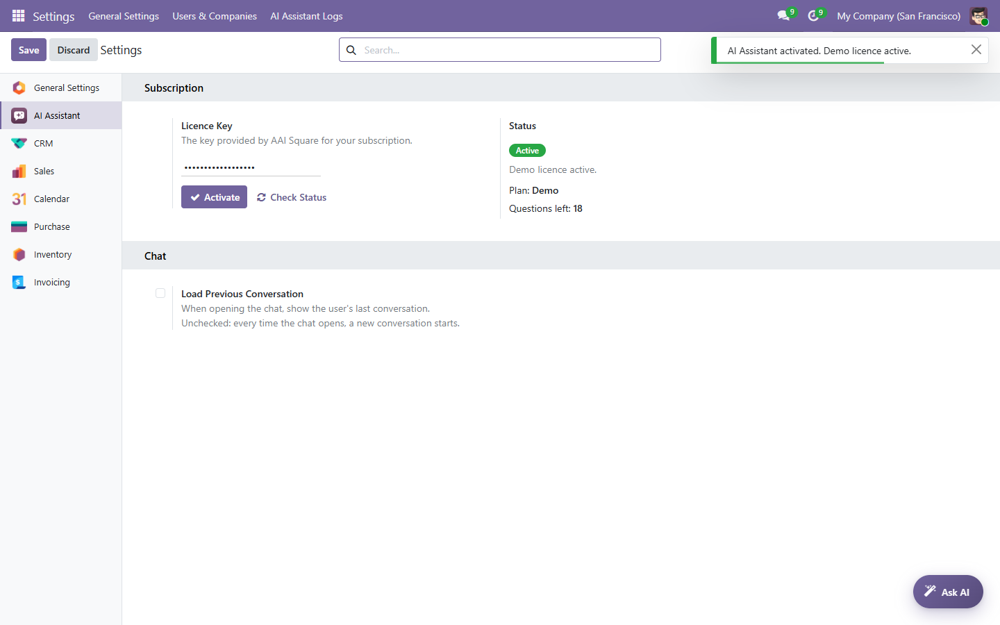
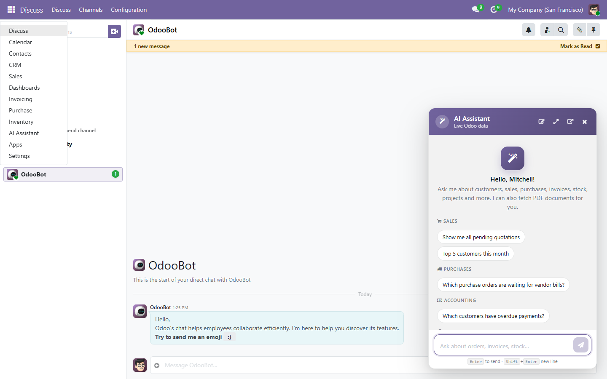
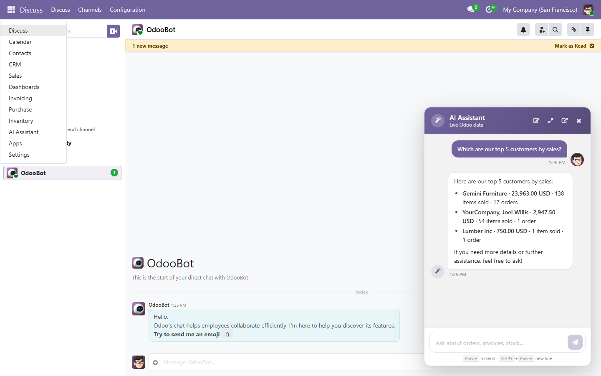
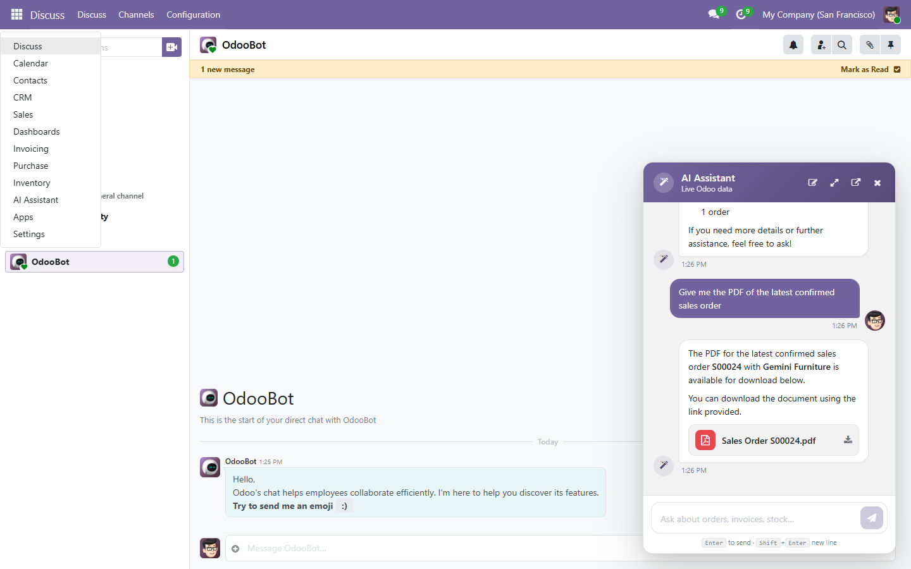
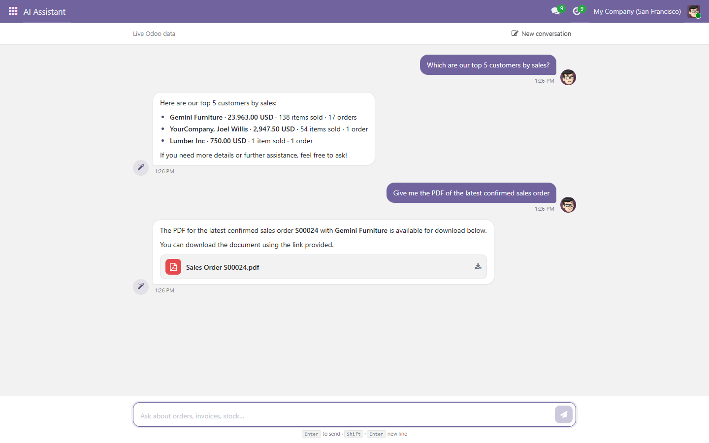

# AI Assistant for Odoo 19.0, by AAI Square

Ask your Odoo anything in plain language. **AI Assistant** adds a chat window to Odoo that answers questions
about your sales, purchases, invoices, stock, customers and CRM from your **live data**, with the access
rights of the user who asks.

> This branch is for **Odoo 19.0** (Community and Enterprise). Other versions: branches `17.0`, `18.0`, `19.0`.



* **20 free questions** with the built-in demo key, no sign-up needed
* **Read-only**: it never creates, changes or deletes anything
* **Respects permissions**: every read runs as the user who asked (access rights, record rules, companies)
* **Documents in one click**: quotation, order, invoice and bill PDFs, plus links to open the records
* **Accurate figures**: totals, counts and rankings are computed by the database, not guessed by the AI

---

## 1. Install

The repository contains the module in a sub-folder (standard Odoo layout, also used by the Odoo Apps Store):

```
aai_odoo_assistance/            <- the repository you clone
├── README.md
└── aai_odoo_assistance/        <- the Odoo module
    ├── __manifest__.py
    └── ...
```

Odoo looks for modules **directly inside** each folder of its `addons_path`, so use **one** of these options.

**Option A: copy the module into your custom addons folder** (simplest)

```bash
git clone -b 19.0 --single-branch {REPO_URL}.git /tmp/aai_odoo_assistance
cp -r /tmp/aai_odoo_assistance/aai_odoo_assistance /path/to/your/custom-addons/
```

On Windows, copy the inner `aai_odoo_assistance` folder with the file explorer.

**Option B: clone it and add the repository folder to `addons_path`** (easy updates with `git pull`)

```bash
cd /opt/odoo
git clone -b 19.0 --single-branch {REPO_URL}.git
```

then in your Odoo configuration file (e.g. `odoo.conf`):

```ini
addons_path = /opt/odoo/odoo/addons,/opt/odoo/custom-addons,/opt/odoo/aai_odoo_assistance
```

The path is the **repository** folder (the one containing `README.md`), not the module folder inside it.

**Option C: Odoo.sh**: add the repository as a submodule of your project (branch `19.0`) and push; Odoo.sh adds it to
the addons path automatically.

Then **restart Odoo**.

**Install it in Odoo:**

1. Activate the developer mode (Settings > Activate the developer mode).
2. Go to **Apps** and click **Update Apps List**.
3. Remove the "Apps" filter, search for **AI Assistant by AAI Square** and click **Install**.

After installing, the chat is **hidden**: nothing changes for your users until an administrator activates it.

Requirements: Odoo 19.0 (Community or Enterprise), the Python `requests` library (included with Odoo),
outgoing HTTPS access from the Odoo server to the AAI Square service.

## 2. Activate

Go to **Settings > AI Assistant** and click **Activate**. A free demo key (`AAI-DEMO-TRIAL-KEY`) is already
filled in.



The page reloads and shows **AI Assistant activated**. The **Ask AI** button appears at the bottom right of
every screen, and the **AI Assistant** app appears in the apps menu.



Who can use the chat: users in the **AI Assistant User** group (the administrator is added at installation).
Add other users in Settings > Users > (user) > AI Assistant.

## 3. Ask questions

Click **Ask AI** and type a question, or pick one of the suggestions.





Ask for a document and download it from the chat:



Use the **open in new tab** button of the chat header for a full-page conversation:



### Questions to try

| Area | Examples |
|---|---|
| Sales | "What is the total value of all open quotations?" · "Top 5 customers this month" · "Give me the PDF of S00025" |
| Purchase | "Which RFQ has the lowest amount?" · "Which purchase orders are waiting for a vendor bill?" |
| Accounting | "Which customers have overdue payments?" · "How many unpaid invoices do we have?" · "Payments received this week" |
| Inventory | "How much stock do we have of FURN_7800?" · "Which deliveries are late?" · "What do we need to reorder?" |
| Customers & CRM | "Show me the profile of Acme Corporation" · "My open opportunities closing this month" · "Pipeline value by stage" |
| Products | "What is the sale price of FURN_7800?" · "Which is our most expensive product?" |

The assistant replies in the language of the question. It only offers what is installed in your database.

## 4. After the 20 free questions

The demo includes **20 questions per database**. To keep using the assistant, subscribe to a plan
(Starter: 1 database, Pro: 2 databases, unlimited questions). We send you a licence key: paste it in
**Settings > AI Assistant > Licence Key** and click **Activate**.

Email **odoo@aaisquare.com** with your company name, Odoo version and edition, and number of users.
More information: https://aaisquare.com/products/odoo-ai-assistant

## Security and privacy

* **Read-only**: the module can only run read requests (search, read, count, group). It cannot create, edit,
  delete, confirm or send anything.
* **Your permissions apply**: requests run as the logged-in user, never with administrator rights.
* **Sensitive data is never read**, even for administrators: passwords, API keys, system parameters,
  mail and payment credentials, attachments.
* **Everything is logged**: administrators see every question and every data request in
  **Settings > AI Assistant Logs**.
* **What is sent to AAI Square**: when you click Activate, your company name, Odoo URL, Odoo version and server
  name (to register the database for the licence). For each question: the question and the records needed to
  answer it. The answer is written by an AI model (OpenAI). Your database is never copied.
* Requests are signed with a secret unique to your database.

## Uninstall

Apps > AI Assistant by AAI Square > Uninstall, like any other module.

## Support

AAI Square · https://aaisquare.com · odoo@aaisquare.com

License: OPL-1 (Odoo Proprietary License v1.0).
